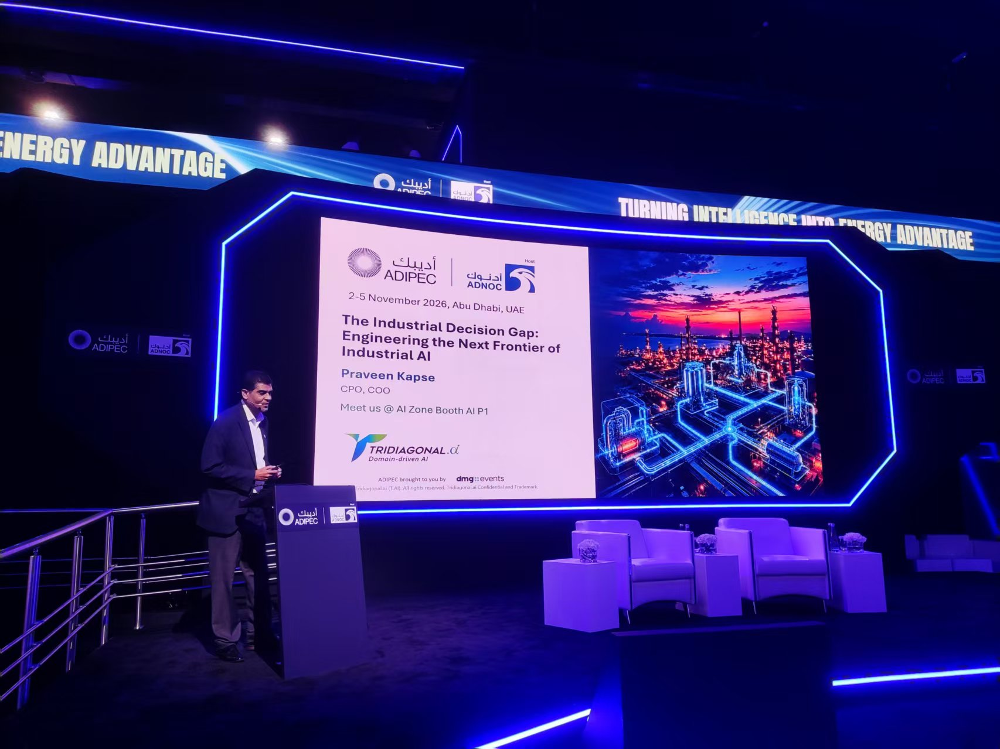
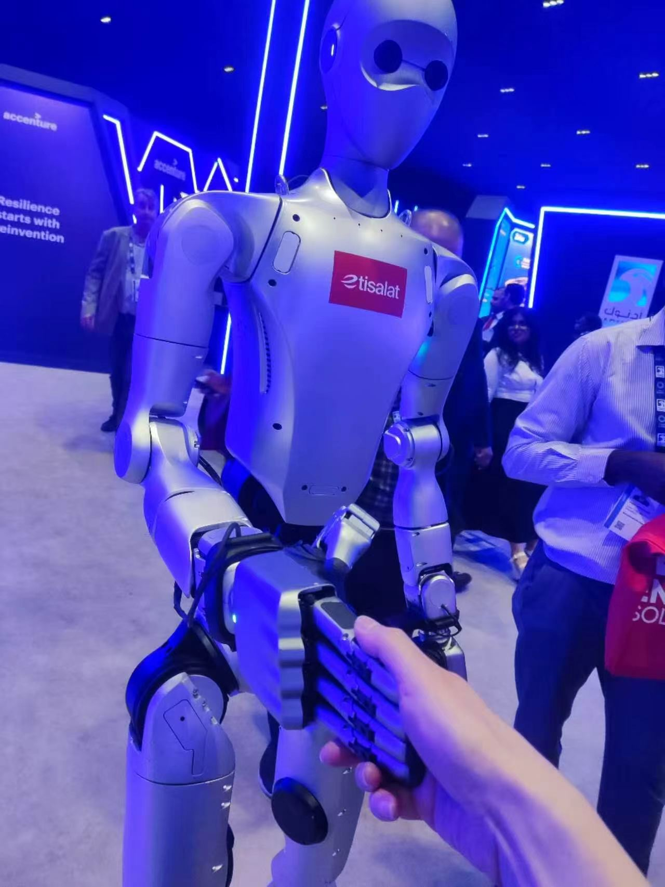
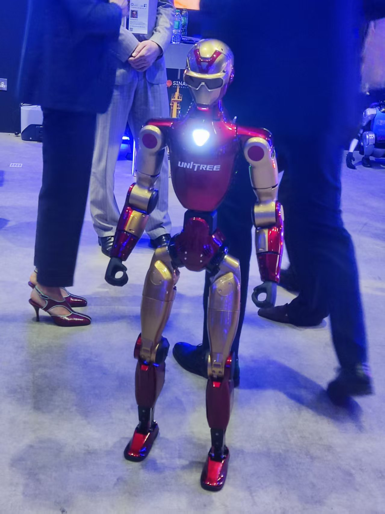

### Conference

**Tridiagonal.AI** 首席产品官兼首席运营官（CPO & COO）**Praveen Kapse** 在 ADIPEC 2026的分享。

这场演讲非常有价值，它讨论的不只是工业AI技术，而是一个更深层次的问题：
**如何让AI从提供信息、预测趋势，真正走向参与工业决策，并帮助企业做出更优、更安全、更具经济价值的决策。**

## 一、演讲基本信息

- **会议：** ADIPEC 2026
- **演讲主题：** The Industrial Decision Gap: Engineering the Next Frontier of Industrial AI
- **中文主题：** 工业决策鸿沟：工程化构建工业AI的下一个前沿
- **演讲嘉宾：** Praveen Kapse
- **职务：** CPO、COO
- **公司：** Tridiagonal.AI

---

## 二、演讲的核心观点：工业AI真正的瓶颈不是模型，而是决策

演讲开篇提出了一个非常重要的判断：

**The problem is not more models. It is engineering the choice between them.**

问题不在于缺少更多的AI模型，而在于如何通过工程化手段，在不同模型、不同方案和不同约束条件之间做出正确选择。

目前工业领域已经积累了大量AI能力：

- 设备状态监测（Monitoring）
- 生产趋势预测（Prediction）
- 运行优化（Optimization）
- 行动建议（Recommendation）
- 跨部门、跨系统协调（Coordination）

演讲通过五个层次解释了工业AI的发展：

| 阶段 | 英文 | 核心问题 |
|---|---|---|
| 1 | Monitor | 现在正在发生什么？ |
| 2 | Predict | 接下来可能发生什么？ |
| 3 | Optimize | 局部最优方案是什么？ |
| 4 | Recommend | 应该采取什么行动？ |
| 5 | Coordinate | 在所有约束条件下，什么方案真正可行？ |

其中最重要的转变是：

传统工业智能主要解决信息获取、状态预测和局部优化问题，而下一代工业AI必须解决跨系统、跨专业、跨业务的综合决策问题。

**从 Component Intelligence（组件智能）走向 Intelligence of Choices（决策选择智能）。**

这也是整场演讲最核心的思想。

## 三、为什么工业AI的预测结果不等于真正的决策？

演讲通过几个工业场景解释了传统AI在实际生产中的局限性。

### 1. 工业生产具有复杂的关联性

演讲举了一个压缩机降负荷（Compressor Derate）的例子。

压缩机降负荷看起来只是一个设备层面的事件，但实际上会产生一系列连锁影响：

| 影响层面 | 可能产生的影响 |
|---|---|
| Equipment（设备） | 可用压缩能力下降 |
| Process（工艺） | 管网背压发生变化 |
| Production（生产） | 油井生产分配需要调整 |
| Commercial（商业） | 出口量及经济价值受到影响 |

这说明：

一个设备的局部变化，可能最终影响整个生产系统，甚至影响企业的商业收益。

因此，工业决策不能仅仅依赖单台设备的AI模型，而需要理解设备、工艺、生产和商业之间的关联关系。

演讲提出：

**Every action propagates through a network of physical and organizational dependencies.**

每一个行动都会沿着物理系统和组织系统中的依赖关系产生连锁影响。

### 2. AI模型完成计算，不代表企业已经完成决策

另一张PPT提出：

**The model finishes. The decision has barely begun.**

模型完成了计算，但真正的决策才刚刚开始。

演讲将实际决策过程划分为四个阶段：

1. Signal：获取信号和模型分析结果。
2. Verify：验证数据、证据和实际工况。
3. Reconcile：协调不同部门之间的利益和技术权衡。
4. Approve：获得授权并确定执行窗口。

例如，AI模型可能已经预测出某台设备存在故障风险，但企业仍然需要考虑：

- 预测结果是否可靠？
- 是否需要停机检修？
- 停机对生产计划有什么影响？
- 是否有备用设备？
- 安全风险和经济损失如何权衡？
- 谁拥有最终决策权？

这就是工业AI落地过程中的 Decision Latency（决策延迟）。

**真正的瓶颈可能不在AI计算速度，而在于企业完成验证、协调、审批和执行的速度。**

## 四、工业决策需要建立新的经济评价体系

演讲提出了一个很有意思的概念：

**The Decision Balance Sheet（决策资产负债表）。**

传统工业优化通常关注产量、效率、成本和利润，但演讲认为，一项决策的价值不能只看它产生了什么，还要看它保留了什么、承担了什么风险。

演讲从四个维度评价工业决策：

| 维度 | 核心指标 | 需要回答的问题 |
|---|---|---|
| Value（价值） | 产量、利润、能源效率 | 实际创造了什么价值？ |
| Exposure（风险敞口） | 安全、可靠性、资产完整性 | 承担了什么风险？ |
| Optionality（选择权） | 冗余、灵活性、产能 | 为未来保留了哪些选择？ |
| Latency（时间成本） | 响应、恢复、干预时间 | 时间是否也成为了成本？ |

这里有一个值得关注的管理理念：

企业不能只追求短期产量和局部效率，还需要考虑安全、可靠性、系统冗余和未来运营灵活性。

例如：

某个优化方案虽然可以短期提高产量，但如果同时降低了设备冗余、增加了安全风险，未必是企业整体最优的方案。

## 五、Tridiagonal.AI提出的新方法：Industrial DecisionOps

这是整场演讲最重要的技术与方法论部分。

Tridiagonal.AI提出了一种新的工业AI应用范式：

**Industrial DecisionOps（工业决策运营体系）。**

它不是简单地增加一个AI模型，也不是传统意义上的数据分析平台，而是通过工程化、治理、执行和持续改进，让工业决策形成完整闭环。

演讲将其划分为五个核心步骤：

| 步骤 | 核心环节 | 主要内容 |
|---|---|---|
| 01 | Contextualize（情境化） | 物理机理、现场拓扑、运行环境 |
| 02 | Validate（验证） | 信号质量、因果证据、持续性验证 |
| 03 | Reason（推理） | 多种假设、约束条件和备选方案 |
| 04 | Authorize（授权） | 人员责任、安全关口、审批机制 |
| 05 | Learn（学习） | 行动追踪、效果衡量、经验复用 |

这五个步骤形成了一个完整的决策闭环。

值得注意的是，演讲并没有将AI定位为完全替代人的决策者。

相反，它强调：

- AI负责分析和推理。
- 工程系统负责验证约束和可行性。
- 管理体系负责审批和授权。
- 人员承担相应的决策责任。
- 执行结果重新反馈到系统中。

最终实现：

**Every critical industrial decision becomes traceable, testable and improvable.**

每一个关键工业决策都能够被追踪、验证和持续改进。

## 六、DecisionOps的整体技术架构

从第15张和第21张PPT的内容来看，演讲进一步展示了DecisionOps的系统架构及实际操作界面。

它主要包含以下几个部分：

### 1. 多领域工业数据接入

系统覆盖多个上游油气生产领域：

- Reservoir：油藏
- Wells：油井
- Facilities：地面设施
- Networks：生产管网
- Compression：压缩系统

这些数据共同构成工业决策的基础。

### 2. 场景分析与模拟

系统支持多种工业场景：

- Supply vs Demand：供需平衡
- Outage Response：设备停机应对
- Market & Price：市场与价格变化
- What-if Cases：假设情景分析
- Risk & Uncertainty：风险与不确定性分析

通过不同场景的模拟，帮助企业评估各种行动方案的影响。

### 3. DecisionOps决策引擎

这是整个架构的核心。

决策引擎综合考虑：

- 跨领域因果关系
- 不同场景之间的比较
- 约束条件下的优化
- 推荐方案及其推理依据
- 审批与决策记录
- 决策结果的持续学习

最终生成：

**Optimal、Feasible、Explainable——最优、可行、可解释的行动建议。**

### 4. 决策输出与执行

系统不仅提供分析结果，还可以辅助企业做出具体行动决策：

- Operate：调整运行方式
- Reallocate：重新分配资源
- Defer / Invest：推迟投资或实施投资
- Mitigate Risk：降低风险
- Maintain：实施维护

因此，DecisionOps的定位不仅仅是展示数据，而是推动实际运营决策。

## 七、DecisionOps在油气行业的六大应用场景

演讲第20张PPT详细介绍了核心应用领域。

| 应用领域 | 主要应用内容 |
|---|---|
| 1. Production Optimization 生产优化 | 井口至出口的生产优化、气举分配、跨井产量平衡、生产恢复 |
| 2. Flow Assurance & Facility Constraints 流动保障与设施约束 | 管网和设施能力分析、分离及压缩约束、产水和水合物约束 |
| 3. Reservoir FDP & Well Placement 油藏开发与井位部署 | 开发方案规划、井位及施工顺序、油藏与地面设施兼容性、资本支出优化 |
| 4. Reliability & Maintenance 可靠性与维护 | 关键设备干预、维护优先级、备用设备冗余、设备隔离及重启策略 |
| 5. Asset Integrity & Compliance 资产完整性与合规 | 腐蚀及侵蚀响应、井筒和管线完整性、运行包络限制、完整性风险管理 |
| 6. Scenario & Decision Intelligence 场景与决策智能 | What-if情景比较、跨领域影响分析、收益与风险权衡、决策建议及决策记录 |

这里体现出一个重要趋势：

工业AI正在从单一设备、单一工艺的智能化，走向油藏、油井、地面设施、生产管网和商业运营之间的综合协同优化。

---

## 八、这场演讲最值得关注的五个启示

结合整场演讲，五个值得工业企业管理者和技术人员深入思考的方向。

**1. 工业AI的竞争重点正在发生变化。**

过去，企业关注谁的算法更先进、预测更准确。

未来，更重要的是谁能够把不同的模型、数据、工程知识和业务规则整合起来，形成真正可执行的决策能力。

**2. 局部最优不等于全局最优。**

设备效率最高、单井产量最大、单项成本最低，并不一定意味着整个生产系统的经济效益最大。

未来的工业AI必须具备跨设备、跨工艺、跨生产系统的协同优化能力。

**3. 决策过程必须可解释、可追溯、可验证。**

在油气等高风险行业，企业借助ai预测结果或优化建议，到批准方案，关注执行后产生了什么结果。

**4. 人机协同仍然是工业AI的重要基础。**

工业AI不应该简单地取代工程师和运营管理人员，而应该帮助他们更快地掌握信息、理解复杂关系、比较方案并做出更好的决策。

**5. 工业AI最终必须创造可衡量的商业价值。**

AI项目不能只用模型精度、算法性能或系统上线数量来评价。

更重要的是实际应用提高能源效率、设备可靠性和安全水平。

---

## 九、总结：这场演讲真正想表达什么？

如果用一句话概括：

**工业AI的下一个发展阶段，不是让机器变得更聪明，而是让工业企业具备更聪明、更快速、更可靠的决策能力。**

过去的工业数字化主要解决三个问题：

- 看得见：通过传感器和数据平台了解生产状态。
- 预测准：通过AI和机器学习预测设备、工艺及生产趋势。
- 优化好：通过算法寻找局部最优运行方案。

而Tridiagonal.AI提出的Industrial DecisionOps，则进一步解决第四个问题：

- **决策优：在复杂的物理约束、生产目标、商业要求和安全要求下，找到真正可执行、可解释、可追溯的最佳行动方案。**

这实际上代表着工业AI从传统的：

**Data → Analytics**

向：

**Prediction → Optimization**

再到

**Context → Validation → Reasoning → Authorization → Execution → Learning**

转变。

---

## 十、对油气行业数字化转型的战略意义

从行业发展角度看，这场演讲传递了一个非常重要的信号：

未来油气企业的核心竞争力，可能不再仅仅取决于拥有多少数据、部署多少AI模型，而在于是否建立了一个能够贯通工程技术、生产运营、资产管理和商业决策的智能决策体系。

这也意味着，未来工业AI的核心竞争领域将逐渐从单点算法能力转向：

1. 工业知识与机理模型的融合。
2. 多系统、多专业的因果关系建模。
3. 复杂约束下的全局优化。
4. AI建议与人工审批的协同机制。
5. 决策执行效果的量化和持续学习。

**最终观点：AI负责提供智能，DecisionOps负责把智能转化为行动，而真正的价值体现在行动带来的经营成果。**

如果将这场演讲作为企业数字化转型的参考案例，我认为最值得研究的不是它展示的AI Dashboard，而是它提出的 **Industrial DecisionOps——将AI、工程知识、业务约束、组织治理和执行反馈整合为一个完整的工业决策闭环。**

---

## 其他

### 1.About Tridiagonal.ai 

Tridiagonal.ai is an Industrial Decision Optimization company within Tridiagonal Group, helping asset-intensive industries transform engineering knowledge, operational data and AI into high-value operational decisions.

Its solutions combine engineering domain expertise, Decision Intelligence, physics-informed AI, industrial AI and decision workflows to improve production optimisation, maintenance reliability, asset integrity, energy efficiency and operational excellence.

By combining engineering expertise with explainable AI, Tridiagonal.ai enables industrial organisations to make faster, safer and more informed operational decisions across the asset lifecycle.

### 2.What we do

Tridiagonal.ai focuses on Industrial Decision Optimization—helping business leaders & engineers evaluate trade-offs, understand operational context and make explainable, high-value industrial decisions. 
Tridiagonal.ai 专注于工业决策优化——帮助企业管理者与工程师全面评估利弊权衡、深入理解运营背景，从而做出具备可解释性的高价值工业决策。

---

**End：**

感谢

btw，传说中阿联酋航空的空姐确实有点好看

